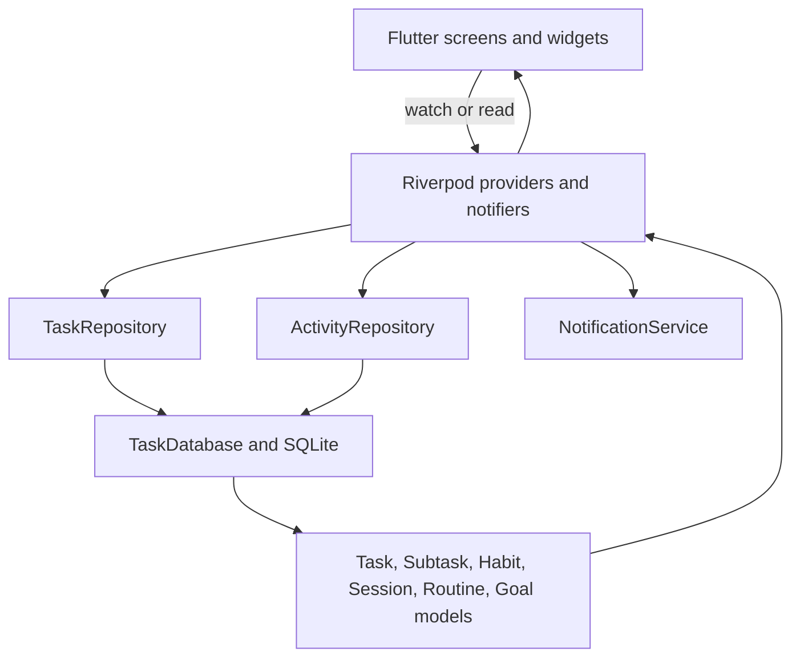

# To-Do App: Project Report and Feature-Building Guide

**Updated:** 2026-10-14  
**Purpose:** Explain how this repository works today and provide a repeatable process for creating a feature independently.

## 1. Project Summary

This is a local-first Flutter productivity application with two top-level areas:

- **To-Do:** tasks, subtasks, priorities, categories, due dates, reminders, pinning, sorting, and progress.
- **Activity:** habits and check-ins, cardio/fitness sessions, reading and writing sessions, reusable routines, goals, a calendar, and daily/weekly/monthly reports.

There is no server or account synchronization in the current app. SQLite on the device is the source of truth. Riverpod loads persisted data, exposes it to widgets, and saves changes through repositories.

The root navigation is responsive: compact layouts use a bottom navigation bar; wide layouts use a navigation rail. An `IndexedStack` keeps the two main screens mounted while the user switches tabs.

## 2. Technology

| Area                     | Current choice                                   | Where it is used                                |
| ------------------------ | ------------------------------------------------ | ----------------------------------------------- |
| UI and application       | Flutter, Material 3                              | `lib/main.dart`, feature screens                |
| State management         | `flutter_riverpod` 3                             | Task and Activity providers                     |
| Persistent database      | SQLite through `sqflite`                         | `lib/data/datasources/task_database.dart`       |
| Desktop database support | `sqflite_common_ffi`                             | Linux and Windows startup setup                 |
| Web database support     | `sqflite_common_ffi_web`                         | Web startup setup                               |
| Reports                  | `fl_chart`                                       | Activity reports                                |
| Dates and display        | `intl`                                           | Date labels and report periods                  |
| IDs                      | `uuid`                                           | New tasks, habits, events, and sessions         |
| Notifications            | `flutter_local_notifications`, timezone packages | Task reminders and Android/iOS habit reminders  |
| Typography               | `google_fonts`                                   | Existing theme uses Inter                       |
| Automated tests          | `flutter_test`, SQLite FFI                       | Database, analytics, provider, and widget tests |

Dependencies are declared in [pubspec.yaml](pubspec.yaml); resolved versions are recorded in `pubspec.lock`.

## 3. Source Layout

| Path                                                                                                               | Responsibility                                                                                                             |
| ------------------------------------------------------------------------------------------------------------------ | -------------------------------------------------------------------------------------------------------------------------- |
| [lib/main.dart](lib/main.dart)                                                                                     | Flutter initialization, notification initialization, platform-specific SQLite setup, `ProviderScope`, theme, and root app. |
| [lib/features/navigation/app_shell.dart](lib/features/navigation/app_shell.dart)                                   | Responsive To-Do and Activity navigation.                                                                                  |
| `lib/features/tasks/screens/`                                                                                      | Task list and task creation/editing screens.                                                                               |
| `lib/features/tasks/widgets/`                                                                                      | Reusable task cards, subtask editing, and button components.                                                               |
| [lib/features/tasks/providers/task_provider.dart](lib/features/tasks/providers/task_provider.dart)                 | Task and subtask state, validation, persistence calls, and task reminders.                                                 |
| `lib/features/activity/screens/`                                                                                   | Activity overview, habits, sessions, routines, calendar, and reports UI.                                                   |
| [lib/features/activity/providers/activity_provider.dart](lib/features/activity/providers/activity_provider.dart)   | Activity loading, validation, mutations, reminders, and state refresh.                                                     |
| [lib/features/activity/analytics/activity_analytics.dart](lib/features/activity/analytics/activity_analytics.dart) | Pure report calculations, date buckets, goals, completion, streaks, and insights.                                          |
| `lib/data/models/`                                                                                                 | Domain objects and SQLite serialization/deserialization.                                                                   |
| [lib/data/datasources/task_database.dart](lib/data/datasources/task_database.dart)                                 | SQLite database opening, schema creation, migrations, and queries.                                                         |
| `lib/data/repositories/`                                                                                           | Domain-facing persistence APIs. Task and Activity have separate repositories.                                              |
| [lib/core/theme/app_theme.dart](lib/core/theme/app_theme.dart)                                                     | Shared Material 3 theme and typography.                                                                                    |
| [lib/services/notification_services.dart](lib/services/notification_services.dart)                                 | Task and activity notification scheduling interfaces and implementation.                                                   |
| `test/`                                                                                                            | Database migration/round-trip, provider/reminder, analytics, and widget tests.                                             |

## 4. Architecture and Data Flow

Screens do not write SQL directly. A screen calls a Riverpod notifier; the notifier validates and applies a domain operation; a repository delegates persistence to `TaskDatabase`; the notifier then publishes refreshed state so the UI reflects the saved snapshot.



### Task flow

- `taskProvider` is an `AsyncNotifierProvider<TaskNotifier, List<Task>>`.
- `TaskNotifier.build()` loads tasks using `TaskRepository`.
- Mutations such as `addTask`, `updateTask`, `setTaskStatus`, `addSubtask`, and `saveTaskOrder` validate domain rules, persist, and publish refreshed state.
- `subtasksProvider` is a family `FutureProvider` keyed by parent task ID.
- Completing a parent task is blocked while it has incomplete subtasks. Reopening a completed parent is an explicit user decision.

### Activity flow

- `activityProvider` is an `AsyncNotifierProvider<ActivityNotifier, ActivitySnapshot>`.
- `ActivityRepository.loadSnapshot()` loads Activity collections in parallel.
- `ActivityNotifier` owns Activity validation and mutations, including habit check-ins, sessions, routine step check-ins, goals, and reminders.
- `ActivityAnalytics` accepts an `ActivitySnapshot` and returns report data. It does not create sample or synthetic activity.

## 5. Current Capabilities

### To-Do

- Create and edit tasks with description, category, priority, start date, optional due date, status, and reminder.
- Filter by category and sort by priority, due date, or creation date.
- Pin and reorder tasks; task cards also manage subtasks.
- Create, edit, and delete subtasks; change status, set reminders, and enforce parent completion rules.
- Display progress and task status counts from the current task list.
- Schedule task reminders through the notification service where platform support and permissions allow.

Task progress is separate from Activity progress. Task status is current-state data, not a historical event stream.

### Activity

- **Habits:** create/edit/archive/restore; set daily or weekly check-in targets; record completed or skipped events; optionally record a numeric value and minutes; view streak counts; configure a reminder time.
- **Sessions:** log cardio, reading, or writing with title, start time, duration, optional distance/calories/pages/words, and completed/skipped status. A foreground timer can create a timed session.
- **Routines:** create a morning, evening, or custom routine with ordered steps; record daily step completion/skipping and optional minutes.
- **Goals:** configure daily or weekly cardio, reading, or writing targets; reports show progress calculated from matching saved sessions.
- **Calendar:** select dates, inspect planned/completed totals, and distinguish target-met, partial, missed, and unplanned days.
- **Reports:** choose daily, weekly, or monthly ranges. Daily reports show hourly data; weekly reports show Monday through Sunday; monthly reports show dates and allow switching between active minutes and habit check-ins. Charts include labels and touch tooltips.
- **Search and filters:** search sessions by title and filter by category, selected date, and completed/skipped status.
- **Quick actions:** add a habit, add a routine, log an activity, start a timed session, or set a goal.

### Reminders and platform behavior

- Task reminders use `TaskReminderScheduler`; Activity reminders use `ActivityReminderScheduler`.
- Activity reminders are scheduled only on Android and iOS. They can recur daily or weekly; weekly reminders use Monday. Activity logging remains available when reminders are unsupported or permission is denied.
- Linux notification launch-detail lookup is optional and guarded because the Linux implementation may throw `UnimplementedError`.
- SQLite factory setup is explicit for web, Linux, and Windows in `main()`; the normal `sqflite` plugin handles supported mobile targets.

## 6. Persistence and Date Rules

The database is currently **schema version 9**. Task and Activity data share one SQLite file, but have separate models, repositories, and state providers.

| Table                   | Stores                                                                                                                                                    |
| ----------------------- | --------------------------------------------------------------------------------------------------------------------------------------------------------- |
| `tasks`                 | Task definition, dates, current status, priority/order/pinning, and reminder configuration.                                                               |
| `subtasks`              | Child task definition, current status, due/reminder data, and sibling order.                                                                              |
| `habits`                | Reusable habit definition, daily/weekly target, archive flag, reminder time, and reminder ID.                                                             |
| `habit_checkins`        | Dated completed/skipped habit records with optional value and duration.                                                                                   |
| `activity_sessions`     | Cardio, reading, and writing records with timestamp, duration, and category-specific measurements.                                                        |
| `routines`              | Reusable routine definition and type.                                                                                                                     |
| `routine_steps`         | Ordered reusable routine steps.                                                                                                                           |
| `routine_step_checkins` | A step's status for a local calendar date and optional duration. Its primary key is step plus day, so the saved row represents that day's current status. |
| `activity_goals`        | One target and unit for a category and daily/weekly period.                                                                                               |

Exact times are stored as epoch milliseconds. Activity date grouping uses a local `YYYY-MM-DD` day key. Keep these meanings separate: a timestamp answers “when,” while the day key answers “which local day.”

Database changes belong in both places:

1. Fresh schema creation in `_createActivityTables()` or the relevant task table creation block.
2. A new, sequential `onUpgrade` migration for users who already have a database.

Do not edit an old migration to add a new field: existing installations have already passed that version. Increment the schema version, write the new migration, and test both a fresh database and an older database. Current Activity-related migrations add the Activity tables, routine-step duration, and habit reminder identifier.

## 7. How to Build a Feature Yourself

Use this sequence for a small feature and keep each step reviewable.

### Step 1: Write the behavior before the code

Write one user story and observable acceptance criteria. For example:

> As a user, I can record my mood once per day, edit today's entry, and see my weekly average.

Clarify:

- What the user can create, read, change, and delete.
- Whether the data must survive restarts.
- What “a day,” “a week,” “complete,” and “skipped” mean.
- Empty, invalid, permission-denied, and duplicate-entry behavior.
- Whether the feature changes an existing screen or belongs in a new tab.

Avoid beginning with a widget. Data and behavior decisions determine the model, migration, and tests.

### Step 2: Trace the closest existing feature

Search for a similar flow and read the path from screen to database:

1. Screen/form: [lib/features/activity/screens/activity_screen.dart](lib/features/activity/screens/activity_screen.dart) or the closest task screen.
2. Provider/notifier: [lib/features/activity/providers/activity_provider.dart](lib/features/activity/providers/activity_provider.dart) or [lib/features/tasks/providers/task_provider.dart](lib/features/tasks/providers/task_provider.dart).
3. Repository: [lib/data/repositories/activity_repository.dart](lib/data/repositories/activity_repository.dart) or [lib/data/repositories/task_repository.dart](lib/data/repositories/task_repository.dart).
4. Database: [lib/data/datasources/task_database.dart](lib/data/datasources/task_database.dart).
5. Model serialization: [lib/data/models/activity.dart](lib/data/models/activity.dart) or [lib/data/models/task.dart](lib/data/models/task.dart).
6. Existing tests under `test/`.

Useful searches:

```sh
rg "class .*Notifier|AsyncNotifierProvider" lib
rg "CREATE TABLE|onUpgrade|version:" lib/data/datasources/task_database.dart
rg "save.*\(|get.*\(" lib/data/repositories lib/features
rg "testWidgets|test\(" test
```

Follow the nearest established convention unless the feature exposes a real reason to change it. Keep Activity concerns out of `TaskNotifier` and task concerns out of `ActivityNotifier`.

### Step 3: Define the domain model and data rules

Before making a form, decide:

- Fields and which are required or optional.
- Stable identity and whether records are edited or append-only.
- Enumerated values and their stored representation.
- Date/time semantics and units.
- Validation bounds and duplicate behavior.
- Whether delete means hard delete or archive while retaining history.

Add `toMap()` and `fromMap()` together. Keep stored enum values stable; changing a database enum name later requires a migration. For date-based Activity data, use `activityDayKey()` for the local date and epoch milliseconds for exact timestamps.

### Step 4: Design persistence and migration

If the feature persists new information:

1. Add the new table/columns/indexes to fresh database creation.
2. Increment `TaskDatabase`'s version and add one forward-only migration.
3. Use parameterized query arguments rather than interpolating user input into SQL.
4. Use a transaction when multiple rows must be saved together.
5. Add repository methods for the operations the UI needs; keep SQL in the datasource.
6. Preserve old data. Prefer archive or a deliberate history-preserving policy for reusable definitions.

For a hypothetical Mood Journal, define a `MoodEntry` model first, then a `mood_entries` table with ID, day key, rating, note, and timestamp. Add the table in fresh creation and migration version 10; do not add mood fields to the task table.

### Step 5: Add repository and state operations

The notifier should expose user-level actions such as `saveMoodEntry()` or `deleteMoodEntry()`, not SQL-shaped actions. In the notifier:

- Validate before writing.
- Throw a clear validation/domain error for invalid values.
- Await repository persistence.
- Refresh/publish state after success.
- Keep state usable if an optional external service, such as notifications, is unavailable.

Decide whether the state should load all history, a date range, or a summary query. The current Activity provider loads collections as a snapshot; very large histories may eventually need database-side filtering or pagination.

### Step 6: Build the UI around states and user tasks

Implement the smallest complete workflow:

1. Loading state.
2. Error state with retry.
3. Empty state with a useful first action.
4. Valid create/edit form.
5. Saved state that visibly updates from provider data.
6. Archive/delete and cancel behavior if applicable.

Use the existing Material 3 theme and mobile patterns. Keep controllers owned by the form/dialog state and dispose them there; do not dispose them immediately after closing a route while its exit animation is still running. Preserve responsive behavior and accessible labels/tooltips.

### Step 7: Isolate calculations from widgets

If the feature needs statistics, put calculations in a pure analytics class like [lib/features/activity/analytics/activity_analytics.dart](lib/features/activity/analytics/activity_analytics.dart). Define formulas explicitly, especially denominators and time boundaries. Charts must consume stored records and show a genuine empty state when no records exist.

For Mood Journal, define what “weekly average” means, how missing days count, and whether the current partial week is included. Test those rules as Dart unit tests before styling a chart.

### Step 8: Add tests at each boundary

- **Model:** map round-trip and defaults/enum parsing.
- **Database:** fresh schema, old schema migration, save/read, date-range query, and preservation of unrelated task rows.
- **Provider:** valid save, invalid save, refresh after save, and optional service failure.
- **Analytics:** empty data, boundary dates, leap months, week start, skips, target denominator, and rounding.
- **Widget:** tab/navigation if affected, create/edit flow, errors, empty state, and persisted result via a fake repository/database.

Use the in-memory database pattern in [test/widget_test.dart](test/widget_test.dart) for widget tests and SQLite FFI in [test/task_database_test.dart](test/task_database_test.dart) for actual SQL/migration tests. Never make a widget test depend on the host's notification plugin.

### Step 9: Verify, inspect, and document

Run:

```sh
dart format <changed-dart-files>
flutter test
flutter analyze
flutter run -d linux
```

Use `flutter devices` to choose an installed target. On a running Flutter app, hot reload refreshes widget code; hot restart is needed when initialization or global state changes. Test a narrow and wide layout when the feature changes navigation or charts. Update this report/README if the architecture or setup changes.

### Step 10: Review the diff before calling it done

Check that:

- Existing task and subtask behavior still passes.
- A new persisted feature has a migration as well as a fresh schema.
- There is no fake/sample progress in production paths.
- Errors and unsupported permissions do not silently destroy user data.
- No unrelated screen or dependency changed without need.
- The README or feature documentation matches implemented behavior.

## 8. Current Constraints and Good Next Improvements

These are implementation boundaries to remember when extending the app:

- **No historical task completion timeline:** `Task.status` is current status only, and there is no task status event table. Do not claim historical task charts from that field. Add task events if that becomes a requirement.
- **Routine recurrence is currently simple:** `period` is stored as morning/evening/custom, but there is no weekday schedule. Analytics currently treats active routine steps as daily opportunities after the routine's creation date. Add explicit schedule data before presenting custom recurrence analytics.
- **Routine management is create-and-track:** the current Activity UI creates routines and records steps, but does not expose full routine edit/archive/reorder workflows.
- **Check-in history semantics differ:** habit check-ins append records; routine step check-ins use `(stepId, dayKey)` as a primary key, so changing a step's status replaces that day's status rather than preserving every transition.
- **Habit measured values are stored, not generally aggregated:** optional per-check-in values persist, while standard habit target/streak reports count check-ins. A measured target such as total milliliters requires explicit unit-aware aggregation and tests.
- **Session editing is limited:** sessions can be logged and deleted; a complete edit workflow is not currently exposed.
- **Timers are in-app timers:** no background service guarantees session timing when the app is suspended or closed.
- **Reminders vary by platform:** Activity reminders are Android/iOS only. Permission denial or unsupported scheduling should not be treated as a failed Activity save.
- **Local-only data:** there is no cloud backup, multi-device sync, or authentication flow wired into the root app.

Treat these as opportunities for well-scoped features, not reasons to refactor unrelated code.

## 9. Test and Analysis Status

At the time this report was written, the project check completed with:

- 33 tests passed across analytics, database migration/storage, notifications/providers, and widget flows.
- `flutter analyze`: no issues found.

Re-run the commands above after making changes; a previous successful run does not verify later edits.
